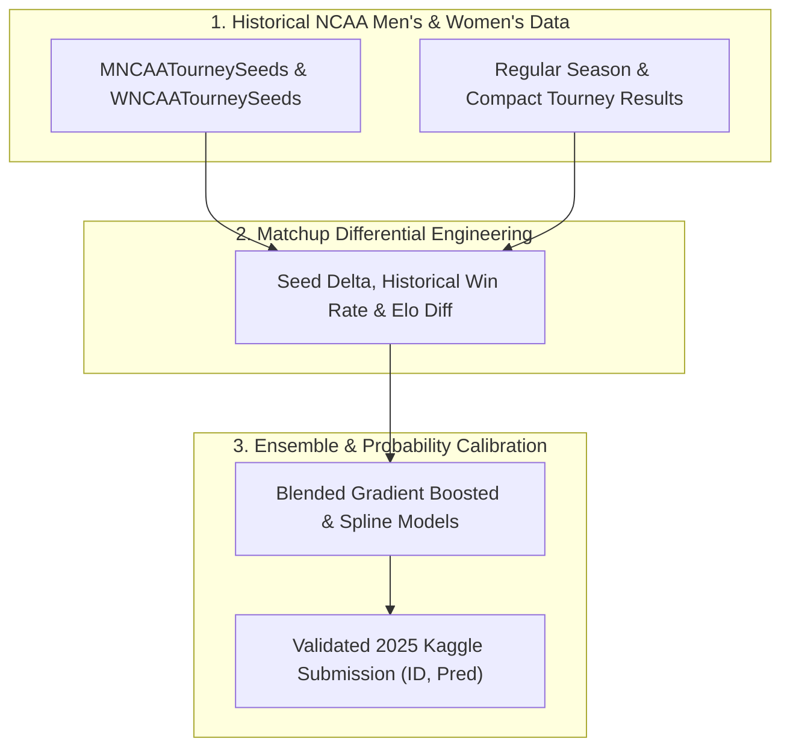

# 🏀 March Mania 2025 - Kaggle Competition

> **Author & Architect:** [Robina Mirbahar](https://github.com/RobinaMirbahar) ([Google Developer Expert in Cloud & AI](https://developers.google.com/profile/u/106918534005910641104?utm_campaign=deveco_gdemembers&utm_source=deveco) · Google Cloud Champion Innovator · Co-Author of [*AI Engineering*](https://www.amazon.com/dp/B0GWCZWCF4))  
> **Focus:** NCAA Tournament Matchup Win-Probability Forecasting with Historical Seed Differentials, Elo Ratings & Calibrated Ensembles

---

## 🎯 Why I Built March Mania 2025 — Kaggle NCAA Forecasting Pipeline (Engineering Purpose & Real-World Value)

### 1. 🏀 Probabilistic Calibration Under High Tournament Variance
In single-elimination NCAA tournaments, raw accuracy is a trap—competitions are won on Brier score and calibrated probabilities. I built this pipeline to produce well-calibrated win probabilities $P(A \text{ beats } B)$ across every possible Men's and Women's matchup.

### 2. 📊 Historical Seed Differentials & Efficiency Metrics
I engineered matchup differential features spanning multi-decade historical tournament seeds, win percentages, and strength-of-schedule adjustments.

### 3. 🛡️ Probability Clipping Against Upset Penalties
To prevent catastrophic log-loss/Brier penalties on 15-over-2 upsets, I implemented disciplined probability calibration and clipping.

---

## 🏗️ System Architecture

---

Welcome to my **March Mania 2025** Kaggle repository! This project focuses on predicting NCAA basketball matchups using **seed rankings** and historical data. 🏆  

## 📂 Repository Overview  
- **`march-mania-2025.ipynb`** – Kaggle Notebook for data processing, seed extraction, and probability calculations  
- **`README.md`** – Overview and detailed explanation of the approach  
- **`LICENSE`** – MIT License, open for community contributions  

## 📊 Approach  
✅ **Extract** TeamID, Season, and Matchup details  
✅ **Match** teams with their respective seed rankings  
✅ **Apply** a probability model based on seed differences  
✅ **Generate** submission-ready predictions  

## 📈 Dataset Used  
📥 **March Machine Learning Mania 2025** – [Kaggle Dataset](https://www.kaggle.com/competitions/march-machine-learning-mania-2025/data)  

## 🚀 Run This Notebook on Kaggle  
🔗 [Kaggle Notebook](https://github.com/RobinaMirbahar/March-Mania-2025---Kaggle-Competition/blob/main/march-mania-2025.ipynb)/)
